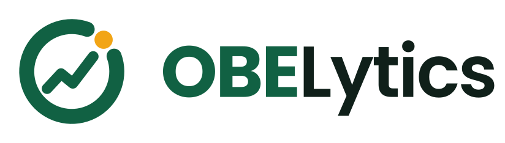
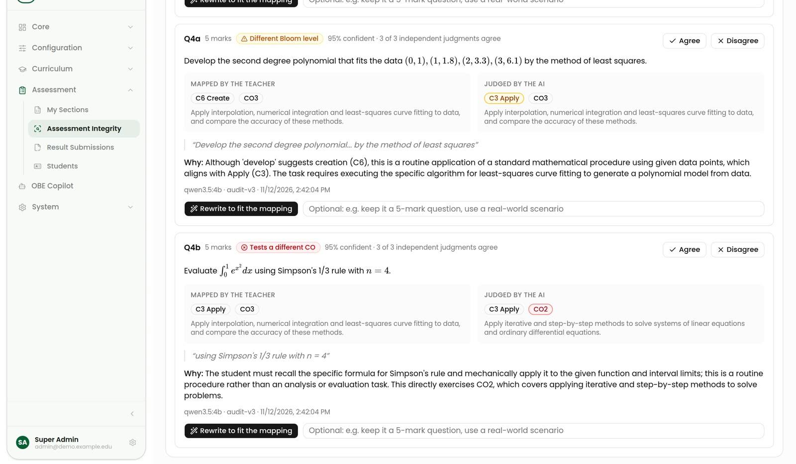
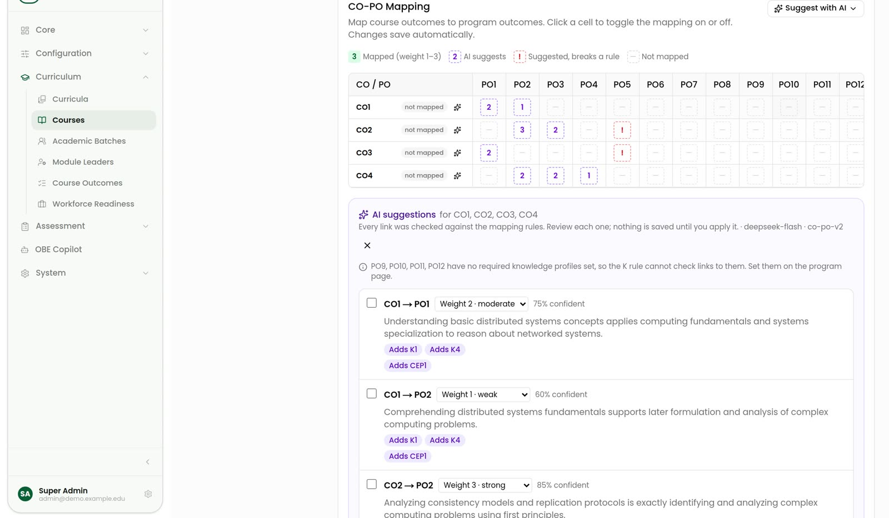
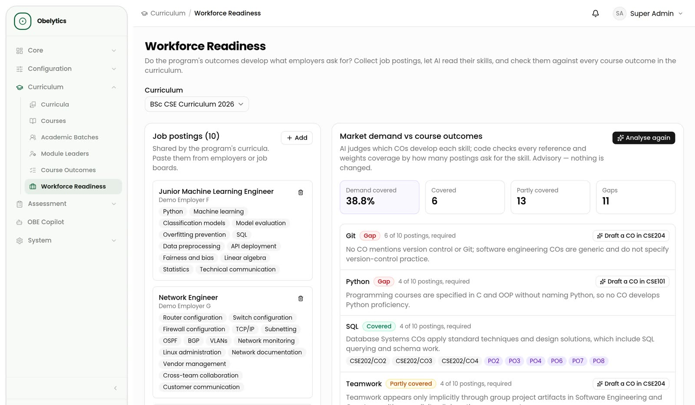
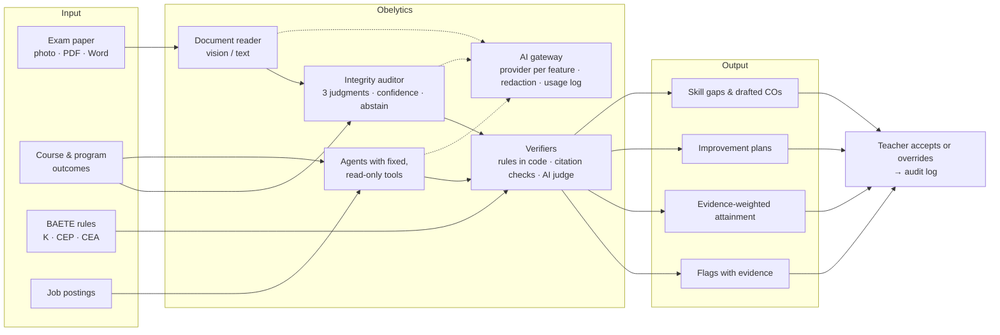

<p align="center">
  
</p>

<p align="center"><b>AI-native Outcome-Based Education and accreditation, built on evidence instead of paperwork.</b></p>

<p align="center">
  <a href="https://obelytics.bitstreamhq.com">Live demo</a> ·
  <a href="docs/ai-congress/">How the AI works</a> ·
  <a href="docs/ai-congress/09_Ethics_and_Governance.md">Ethics &amp; safeguards</a> ·
  <a href="SETUP.md">Setup</a>
</p>

---

## The problem

To be accredited, an engineering degree has to prove that its graduates can do what it promises. Bangladesh's BAETE, the Washington Accord and ABET all require a program to define program and course outcomes, map them to each other and to international standards, tag every exam question with the outcome and Bloom level it tests, compute attainment from marks, and show improvement term after term.

In most universities this cycle lives in spreadsheets, and nobody checks it. A course can report that most students can *analyze algorithm complexity* when its exam only asked them to recall definitions. Outcomes are also rarely compared with the skills employers actually ask for.

## What Obelytics does

Obelytics runs the whole cycle in one platform, and AI works at every stage. **The AI advises and teachers decide.** Every AI result is explained and checked by code or by a second AI judge.

| Stage | Platform | AI |
|---|---|---|
| **Design** | Program outcomes, versioned curricula, full course design that produces the official outline | Imports an existing Word or PDF course outline; drafts and refines course outcomes (COs), with quality checks in code |
| **Map** | CO–PO matrix with weights; knowledge profiles (K), complex problems (CEP) and complex activities (CEA) | Suggests CO–PO links with reasons and confidence. BAETE's mapping rules are enforced in code, so a suggestion that breaks one can't be applied |
| **Assess and verify** | Question-wise marksheets, approval workflow (teacher → module leader → coordinator) | **Integrity auditor.** Reads an uploaded paper (phone photo, scanned PDF or Word file) and judges what each question really tests without seeing the teacher's tags. Flags mismatches with the quoted question, a reason and a confidence. Can rewrite a weak question, then re-check the rewrite blind |
| **Measure** | CO and PO attainment, course-end reports, a student portal | **Evidence-weighted attainment.** Shows the official figure next to the figure the exam evidence supports; it never overwrites the official one |
| **Improve** | Automatic detection of attainment gaps | **Improvement agent.** Fixed, read-only tools find which questions and teaching weeks caused a gap; every fact it cites is checked in code |
| **Workforce** | Job postings per program, imported from links or CSV | Reads the skills employers ask for, merges near-duplicates, scores how well the curriculum covers them (weighted by demand), and drafts a CO for each gap. Students see which in-demand skills their own results verify |
| **Accredit** | Accreditation cycles and criteria mapped to POs | **Evidence writer.** Drafts report sections from the program's records and the accreditor's manual (full-text retrieval). Every sentence cites its sources; code flags any citation or number it can't find |
| **Ask** | — | Role-aware OBE Copilot over the program's own data |

<p align="center"></p>
<p align="center"><sub>Integrity auditor: the teacher tagged Q4a "Create", and three independent AI judgments agree it only asks students to apply a taught procedure. Demo data.</sub></p>

<p align="center"></p>
<p align="center"><sub>CO–PO suggestions: links that break a BAETE rule are marked and can't be applied. Demo data.</sub></p>

<p align="center"></p>
<p align="center"><sub>Workforce readiness: demand-weighted skill coverage, gaps, and "Draft a CO". Synthetic job postings.</sub></p>

## How the AI is kept trustworthy

- **Advisory only.** AI never changes a mark or an official attainment figure. Teachers accept or override every result, and an override needs a reason.
- **Explained.** Every flag shows the quoted evidence, a reason, a confidence, and the model and prompt version that produced it.
- **Abstains when unsure.** The auditor makes three independent judgments per question. Its confidence comes from how often they agree, and below a threshold it says "not sure".
- **Checked.** Generated output is verified before a teacher sees it: accreditation rules and agent citations by code, rewrites by an independent AI judge.
- **No student data to external models.** Every model call goes through one [AI gateway](backend/app/modules/ai/). It picks the institution's provider per feature (self-hosted via Ollama, or a hosted OpenAI-compatible API), removes personal data before any external call, and logs every call.
- **Tested against gaming.** A robustness set checks that padding a question with higher-order verbs, or planting instructions in it, doesn't change the judgment.

Details: [AI build plan](docs/ai-congress/06_AI_Upgrade_Build_Plan.md) · [evidence and validation](docs/ai-congress/07_Evidence_and_Validation.md) · [ethics and governance](docs/ai-congress/09_Ethics_and_Governance.md).

## Architecture



| Layer | Technology |
|---|---|
| Frontend | Next.js 16 (App Router), React 19, TypeScript, Tailwind CSS 4, shadcn/ui, TanStack Query, Zustand |
| Backend | FastAPI (Python 3.12), SQLAlchemy async, Alembic, ~340 endpoints across 20 domain modules |
| Data | PostgreSQL 16 (17 schemas, every record scoped to an organization), Redis + arq for background AI jobs, MinIO |
| AI | Own gateway over Ollama (self-hosted, e.g. Qwen) and any OpenAI-compatible API (e.g. DeepSeek); versioned prompts; gold-set, robustness and mapping evaluation scripts |
| Deploy | Docker Compose behind nginx with TLS; migrations run as a one-shot service |

Roles: Super Admin, Program Coordinator, Module Leader, Section Teacher and Student, with permission-aware access to every endpoint. The interface is available in English and Bangla (বাংলা).

## Use it from an AI agent (MCP)

Obelytics is also a [Model Context Protocol](https://modelcontextprotocol.io) server. `POST /api/v1/mcp` offers seven fixed, read-only tools (outcome attainment, paper audits, skill coverage, PO–CO maps, accreditation-manual search). Each tool runs with the caller's own permissions and returns class-level data only. Connect any MCP client with a bearer token, for example `npx mcp-remote https://obelytics.bitstreamhq.com/api/v1/mcp --header "Authorization: Bearer <token>"`.

## Run it locally

```bash
# 1. Infrastructure (Postgres, Redis, MinIO)
cd backend && docker compose up -d

# 2. Backend
python -m venv .venv && source .venv/bin/activate
pip install -r requirements-dev.txt
cp .env.example .env
alembic upgrade head
# create an organization and admin, then reference data: see SETUP.md
uvicorn app.main:app --reload --port 8000

# 3. Frontend
cd ../frontend
npm install
echo "NEXT_PUBLIC_API_URL=http://localhost:8000" > .env.local
npm run dev
```

AI features need either [Ollama](https://ollama.com) running locally (`AI_LOCAL_*` in `.env`) or a hosted OpenAI-compatible key (`AI_HOSTED_*`). Tests use a fake model (`tests/ai_fakes.py`), so no model server is needed to run `pytest`.

Full guide: [SETUP.md](SETUP.md) · Production: [DEPLOY_VPS.md](DEPLOY_VPS.md) · Contributor notes: [AGENTS.md](AGENTS.md)

## Data notice

This repository contains no student data. Demo organizations use generated names, `@student.example.edu` addresses and synthetic marks and job postings. Real exam papers used to evaluate the auditor are kept private.

## Context

Obelytics is being built for Daffodil International University's CSE program and is an entry in the International AI Builders Congress 2026 (LearnSphere AI → Workforce Ready).
