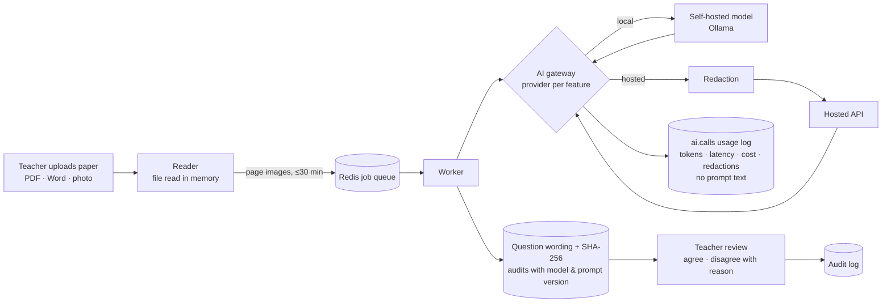

# 09 — Ethics, Data Sovereignty and Governance

This is Obelytics' ethics pack: the principles every AI feature follows, where data goes and stays, how long it is kept, what the models are and are not for, how we check for bias, and the risks we track. Everything here describes the code as it is; planned work is marked as planned.

## 1. Principles

1. **Advisory only.** The AI never changes marks or official attainment.
2. **The headline AI never sees student data.** The auditor reads question text only; attainment uses aggregates.
3. **Humans decide.** Every flag can be accepted or overridden with a reason; overrides are logged.
4. **No faculty ranking.** No view ranks or scores individual teachers; reporting is aggregated by course and program.
5. **Explain every output.** Quoted evidence, reason, confidence; abstain when unsure.
6. **Traceable.** Every AI output stores the model and prompt version that produced it.

## 2. Data and sovereignty strategy

**Who owns the data.** Each institution owns everything it puts into Obelytics. Every record carries its organization's id and every query is scoped to it; one institution never sees another's data.

**Where it lives.** In the institution's own deployment: PostgreSQL, Redis and object storage run inside one Docker Compose stack, on the institution's server or on a server it chooses. Nothing is stored with a model provider.

**What can leave the server, by feature.** Each institution picks a provider per feature on the AI Settings page: `local` (a self-hosted model through Ollama; nothing leaves the server), `hosted` (an OpenAI-compatible API) or `off`.

| Feature | What the model is sent | Student data? |
|---|---|---|
| Paper reading (`integrity`) | The question paper's text, or its page images | No (papers carry none; a printed setter's name may appear on a photo) |
| Integrity audit and question rewrite (`integrity`) | Question wording, the course's outcome statements | No |
| Outcome writing, CO–PO suggestions, outline import (`authoring`) | Course text, outcomes, program outcomes, the BAETE knowledge-profile rules | No |
| Workforce analysis (`authoring`) | Job-posting text, the curriculum's course outcomes | No |
| Improvement agent (`improvement`) | Class-level figures returned by four fixed, read-only tools | No: class totals only, never one student |
| OBE Copilot (`copilot`) | The question asked and curriculum context the user's role allows | Possible if a user types it; the gateway redacts known patterns first |
| Student "My Skills" view | Nothing: computed in code | Never reaches a model |

**Redaction.** Before any `hosted` call, the gateway removes email addresses, phone numbers (including Bangladeshi formats), student-ID patterns (including DIU-style IDs), the signed-in user's name, and an optional institution-specific pattern. The number of redactions is logged with the call.

**Residency.** An institution that must keep all data in the country deploys on a server in the country and sets every feature to `local`. The hosted model is optional and chosen per feature.

**Lawful sourcing.**
- Real past question papers used to evaluate the auditor come from the DIU question bank, collected with the bank owner's approval (verbal; written approval requested). They contain no student data and are kept out of the public repository.
- Demo organizations use synthetic students (`@student.example.edu`, sequential ids), synthetic marks and synthetic job postings.
- Imported job postings are what an institution chooses to add; the importer asks them to add only postings they may use.

## 3. Data flow

## 4. Retention

| Data | Kept | Notes |
|---|---|---|
| Uploaded paper or outline file | Not stored | Read in memory; only a SHA-256 fingerprint is kept |
| Page images of a photo or scan | At most 30 minutes, in Redis | Deleted when the worker has read them (`INTEGRITY_JOB_TIMEOUT_SECONDS`) |
| Question wording | With the marksheet, as long as the course data | Teachers can correct or clear it |
| AI outputs (audits, rewrites, suggestions, plans, analyses) | As long as the course data | Needed to show why a figure is what it is; each stores model and prompt version |
| `ai.calls` usage log | As long as the organization | Metadata only: feature, model, tokens, latency, cost, number of redactions |
| Audit log of decisions | As long as the organization | Who accepted or overrode what, and why |

**Deletion on request.** An institution can ask for its organization's data to be deleted; today the operator does this. A self-service export-and-delete tool is planned.

## 5. Model card

**Intended use.** Help teachers and quality-assurance staff check that exam questions test the outcome and Bloom level they are mapped to; draft course outcomes and mappings; explain attainment gaps; compare outcomes with job-market skills. Every output is advice to a person who decides.

**Out of scope.** Grading or ranking students; evaluating or ranking teachers; changing marks or official attainment; any decision without a person's review.

**Models.**

| Use | Default | Alternatives |
|---|---|---|
| Judging (audit, rewrites, outcomes, mappings, agent, workforce) | DeepSeek V4 Flash (`deepseek-v4-flash`), hosted | Any OpenAI-compatible model; a self-hosted model through Ollama |
| Reading photos and scans | A vision-capable model the institution configures | Self-hosted Qwen through Ollama |

Off-the-shelf models with versioned prompts; nothing is trained or fine-tuned on institutional data.

**Prompts (current versions).** `extract-v4`, `extract-text-v1` (reading); `audit-v3` (judging); `rewrite-v2`; `co-draft-v2`, `co-refine-v1`, `co-po-v2`, `outline-v1` (authoring); `job-skills-v1`, `skill-coverage-v2` (workforce); `improve-v1` (agent); `copilot-v1`. All teacher- and document-supplied text is fenced as data.

**How judgments are made.** Three independent judgments per question; confidence is how often they agree times the stated confidence; below 0.5 the auditor abstains ("not sure").

**Evaluation so far.** Development measurements against reference labels written by a separate, stronger AI model, not by faculty (see `07` §8). On 226 real DIU CSE questions the hosted model agreed on the exact Bloom level for 80% and within one level for 94% of the questions it answered. A faculty panel's labels are pending; until then no accuracy figure is claimed as faculty-validated.

**Known limitations.**
- Weaker on lower-order (recall and understanding) questions and on prose-heavy courses; see §6.
- Small self-hosted models judge by verbs: padding a question with higher-order verbs raised the local 4B model's level in 9 of 14 cases (0 of 14 for the hosted model).
- Redaction is pattern-based; it cannot find every name typed freely into the copilot. Photos sent to a hosted vision model are not redacted.
- Outcome-alignment accuracy is not yet measured, because the gold set needs the current course outlines.

## 6. Bias evaluation

**Method.** `scripts/integrity_gold_set.py strata` reports the auditor's accuracy for each group of questions:
- exam (mid or final) and course;
- the reference Bloom level (lower- or higher-order);
- wording style: math, code, a shared scenario, a figure, short or long.

For each group it reports exact and within-one agreement, how often the AI abstained, and the mean signed level gap (above 0 means it rates that kind of question higher than the reference). Groups under 8 questions are marked too small to read.

**Results (2026-11-17, hosted model, `audit-v3`, 221 questions; reference labels, not faculty).**

| Group | n | Exact | Within one | Mean gap |
|---|---:|---:|---:|---:|
| Higher-order questions (C3–C6) | 168 | 82% | 96% | +0.05 |
| Lower-order questions (C1–C2) | 53 | 73% | 84% | +0.25 |
| Math in the wording | 25 | 92% | 100% | 0.00 |
| No math | 196 | 78% | 93% | +0.11 |
| Mid-term | 89 | 79% | 95% | +0.01 |
| Final | 132 | 80% | 92% | +0.15 |
| Weakest course: Software Engineering | 12 | 42% | 83% | −0.08 |
| Strongest course: Compiler Design | 16 | 100% | 100% | 0.00 |

**What we do about it.**
- Weak groups are published here, not hidden.
- Lower-order and prose-heavy questions show their confidence, and teachers can override any of them.
- The faculty panel will re-run this breakdown on faculty labels.

**Not measurable yet.** Department, and theory versus lab: every gold-set question is from a CSE theory course. A second department's papers are needed. Bangla-medium wording: one synthetic Bangla paper of 6 questions was read exactly; the audit matched the English version on 5 of 6 questions and abstained on the sixth. That is too small a sample to claim more.

## 7. Consent note for past question papers

Template for a department head, kept with the evaluation set:

> The Department of ______ permits the Obelytics team to use past midterm and final question papers of the courses listed below, from terms ______ to ______, to evaluate an AI tool that checks whether exam questions test their mapped course outcomes. The papers contain no student data. They will be stored privately, not published, and used only for this evaluation; no paper will be shown in public without the department's further permission. Results will be reported in aggregate, not per teacher.
>
> Name, designation, signature, date: ______

## 8. Risk register

| Risk | Mitigation |
|---|---|
| Misclassification unfairly reflects on a teacher | Advisory only; override with reason; confidence threshold; abstain |
| Function creep into faculty performance evaluation | No per-teacher ranking views; aggregate-only reporting; stated in terms of use |
| Student data leakage | Auditor uses no student data; redaction in gateway; self-host option; My Skills computed without a model |
| Bias against certain disciplines or writing styles | Per-group evaluation (§6); weak groups published |
| Prompt injection via teacher-entered or imported text | Text fenced as data; fixed tool allowlists; injection cases in the robustness set |
| Server-side request forgery through job-posting links | Importer fetches public addresses only, re-checks every redirect, caps size and time |
| Over-reliance on AI judgments | Confidence shown; human sign-off required |
| Gaming the auditor (stuffing "analyze" verbs) | Classify by cognitive demand; robustness test set |
| Model or provider change shifts behaviour | Versioned prompts; evaluation re-run on every change |
